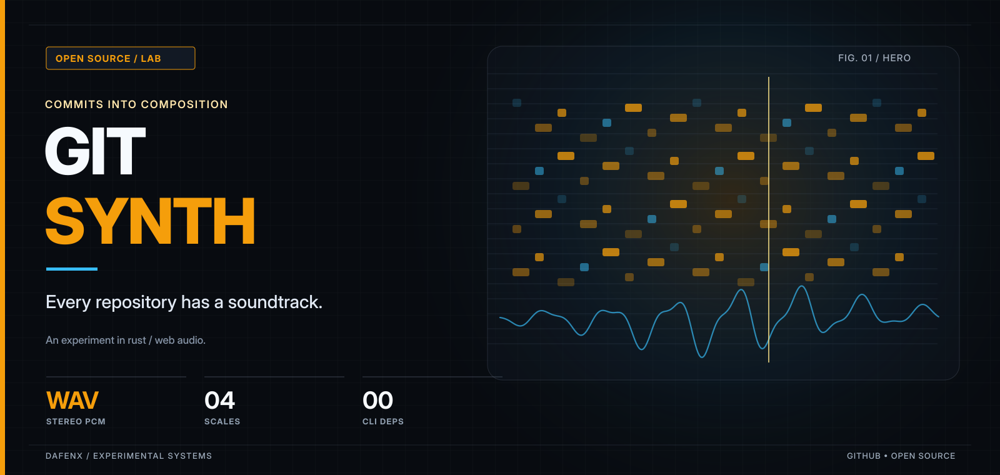
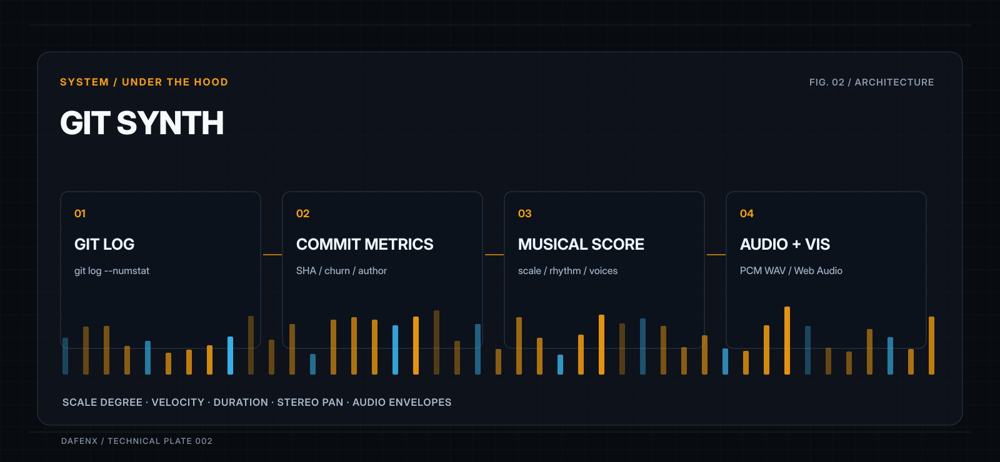

<p align="center">
  
</p>

<p align="center">
  <a href="https://github.com/Dafenxz0/git-synth/actions/workflows/ci.yml"></a>
  <a href="https://dafenxz0.github.io/git-synth/"></a>
</p>

# git-synth

### Every commit is a note. Every repo has a score.

A pure-Rust command-line synthesizer and browser-based Web Audio player that transform **Git commit history** into polyphonic music. The same idea has two outputs: an actual **16-bit stereo WAV** and an interactive piano-roll visualization.

<p align="center"><a href="https://dafenxz0.github.io/git-synth/"><strong>LISTEN IN THE BROWSER</strong></a></p>



## Start with your own repository

```bash
git clone https://github.com/Dafenxz0/git-synth.git
cd git-synth
cargo run --release -- --repo . --output git-synth.wav
```

For a dependency-free demonstration using a bundled sample commit history:

```bash
cargo run --release -- --sample --scale lydian --output sample.wav
```

Try another repository and musical setting:

```bash
cargo run --release -- --repo /path/to/repo --scale dorian --tempo 128 --max-commits 64 --output repo.wav
```

The CLI needs **Git** installed for `--repo` input. The Rust crate itself uses **no external crates**.

## What becomes music?

| Git signal | Musical result |
| --- | --- |
| Commit SHA and main file extension | Quantized scale degrees and arpeggio motif |
| Added + removed lines | Velocity, note duration, rhythmic density |
| Mixed file extensions | Additional seventh interval in the pad chord |
| Author and change balance | Stereo positioning |
| Chronological order | Arrangement over time |

Choose among **Pentatonic**, **Dorian**, **Lydian** and **Minor** scales. The synthesis engine produces bass, arpeggio and detuned pad voices using envelopes, stereo panning and a soft limiter. The terminal additionally displays an ANSI-colored Goertzel spectrum timeline.

## Two ways to listen

**CLI:** render a 44.1 kHz, 16-bit stereo PCM WAV with Rust; choose scale, root, tempo and commit limit.

**[Browser player](https://dafenxz0.github.io/git-synth/):** stream a public GitHub repository into a Web Audio arrangement, or select a built-in offline preset. Explore the Canvas piano roll and FFT spectrum while playback runs.

### CLI options

| Option | Default | Purpose |
| --- | --- | --- |
| `-r, --repo <PATH>` | `.` | Git repository path |
| `-o, --output <FILE>` | `git-synth.wav` | Output WAV path |
| `-s, --scale <NAME>` | `pentatonic` | `pentatonic`, `dorian`, `lydian`, `minor` |
| `-t, --tempo <BPM>` | `120` | Tempo, 40–240 BPM |
| `-n, --max-commits <N>` | `48` | Number of commits to process |
| `--root <MIDI>` | `48` | Root pitch, MIDI 24–72 |
| `--sample` | off | Use bundled history |
| `--no-color` | off | Remove ANSI colors from console output |

## Architecture

| Layer | Files |
| --- | --- |
| Git parsing | [`src/git_log.rs`](src/git_log.rs) |
| Quantization and scoring | [`src/music.rs`](src/music.rs) |
| Waveforms, envelopes and WAV encoding | [`src/synth.rs`](src/synth.rs) |
| ANSI spectral display | [`src/viz.rs`](src/viz.rs) |
| Browser synth and Canvas player | [`web/app.js`](web/app.js) |

## Verify

```bash
cargo fmt --all -- --check
cargo clippy --all-targets -- -D warnings
cargo test
```

The composition is a **deterministic sonification of repository metadata**, not a transcription of source code or an AI-generated song. Different repos can have similar musical textures because the mapping intentionally reduces a large history to a small set of musical controls.
